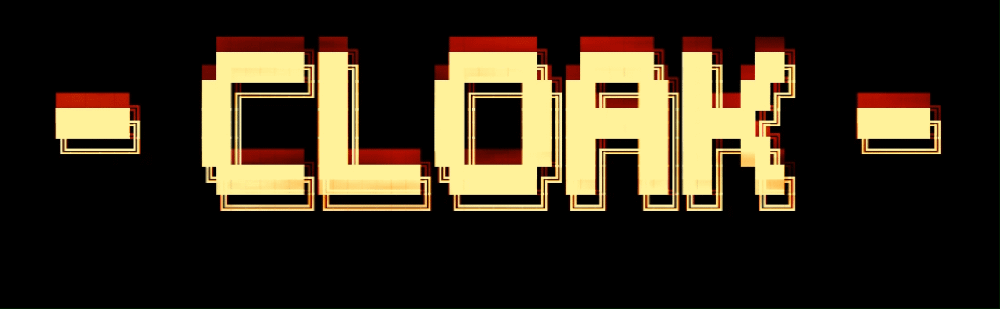

<div align="center">



**Route all of your machine's traffic through Tor, with a kill-switch.**

[](LICENSE)


One command: `cloak on | off | check`

Designed and tested on **Kali WSL2**, works on regular Linux too.

</div>

---

> **Warning**
> `cloak` hides your transport layer (IP + DNS). It is not magic anonymity
> (browser fingerprint, cookies, accounts...). ICMP and UDP cannot traverse Tor,
> so in `on` mode they are **blocked**. That is the kill-switch working, not a bug.

## Table of contents

- [Features](#features)
- [Requirements](#requirements)
- [Installation](#installation)
- [Usage](#usage)
- [How it works](#how-it-works)
- [Limitations](#limitations)
- [Troubleshooting](#troubleshooting)
- [Uninstall](#uninstall)
- [License](#license)

## Features

- Transparent TCP and DNS redirection through Tor
- Kill-switch blocking ICMP, UDP and non-torified IPv6
- Bootstrap wait before arming the kill-switch
- Automatic self-test with rollback on failure
- Idempotent, marked, backed up and validated torrc block
- Scriptable status check with exit codes
- Automatic sudo escalation for `on` and `off`

## Requirements

- Linux with `apt`, `dnf` or `pacman` (Debian, Ubuntu, Kali, Fedora, Arch)
- On WSL2, systemd is recommended. Without it a `service` fallback is used.

## Installation

One-liner:

```bash
curl -fsSL https://raw.githubusercontent.com/linoMlv/cloak/main/install.sh | sudo bash
```

Or from a clone:

```bash
git clone https://github.com/linoMlv/cloak && cd cloak
sudo ./install.sh
```

The installer installs `tor`, `iptables`, `curl` and `iputils-ping`, drops `cloak`
into `/usr/local/bin`, writes a marked block into `/etc/tor/torrc` (with backup and
validation), and removes the legacy `tor-on` / `tor-off` / `tor-check` scripts if found.

WSL users should enable systemd in `/etc/wsl.conf`:

```ini
[boot]
systemd=true
```

Then run `wsl --shutdown` from Windows. Without systemd, a `service` fallback is used.

## Usage

```text
cloak on      # tor + transparent redirection + kill-switch   (auto-sudo)
cloak off     # back to direct traffic, tor stopped           (auto-sudo)
cloak check   # IP, torproject/ipify consistency, geolocation, latency, kill-switch
```

`cloak check` exit codes, ready for scripting:

| Code | Meaning      |
|------|--------------|
| 0    | torified     |
| 1    | direct       |
| 2    | undetermined |

## How it works

```
    applications (curl, apt, nmap -sT...)
             |
             | TCP + DNS
             v
  iptables nat OUTPUT (REDIRECT)
  tcp/dns -> 127.0.0.1:9040 / :5353
             v
     Tor TransPort / DNSPort
             v
     Tor network (onion encryption)
             v
       exit node -> Internet

  Kill-switch (filter table): only traffic already redirected to Tor and
  tor's own traffic pass. ICMP, UDP and non-torified IPv6 are blocked.
```

- Tor runs under its own user, and the `--uid-owner` rule excludes it from the
  redirection (otherwise it would loop).
- `cloak on` waits for the Tor **bootstrap** before applying the kill-switch and
  performs an automatic **rollback** if the self-test fails, so you cannot cut
  your own network with a dead Tor.
- The rules live in RAM, so after a WSL restart the machine boots back into
  direct mode (safe by default).

## Limitations

- ICMP and UDP are blocked in `on` mode (Tor only carries TCP), so `ping` stops answering.
- The LAN and the Windows host are no longer reachable (Tor exits refuse private IPs).
  To keep them, uncomment the LAN `RETURN` rule in `cmd_on`.
- No inbound traffic, set up an onion service on the tor side if needed.
- On corporate networks filtering Tor, configure obfs4 bridges (`obfs4proxy`).
- Only this Linux machine is torified, not the Windows host system.

## Troubleshooting

| Symptom | Lead |
|---|---|
| `cloak on` reports "Tor did not bootstrap" | `journalctl -u tor -n 50`, filtering network means bridges |
| DNS no longer resolves in on mode | `/etc/resolv.conf` must not point to `127.0.0.53` |
| Nothing gets through in on mode | `iptables -L TOR_FW -nvx`, the `-d 127.0.0.0/8` counters should increase |

## Uninstall

```bash
sudo bash uninstall.sh
```

The `tor` and `iptables` packages are kept, only the cloak block is removed from the torrc.

## License

MIT, see [LICENSE](LICENSE).
